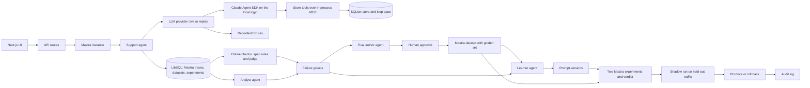

# Agent Learning Loop

A support agent that learns from its own traces: failing runs become reviewed eval cases, a prompt fix is gated by two Mastra experiments, then shadowed, promoted and rolled back.


Full video: https://github.com/ArchiusVuong-sudo/agent-learning-loop/releases/download/v0.1/demo.mp4

## What it does

- Runs a customer support agent for a synthetic outdoor gear store on Mastra, with six store tools (policy search, customer and order search, order lookup, return eligibility, create return, escalate to a human) served over an in-process MCP server. Every run is a Mastra trace with the agent run, the model call and each tool call.
- Checks every trace online with four span rules (tool errors, eligibility before a return, policy claims backed by a lookup, required escalation) and a grounded-reply judge on a different model than the agent.
- Tags each trace with an analyst agent (goal, outcome, behaviors) and groups the failures by behavior, so the loop works on patterns instead of single chats.
- Drafts regression cases from the largest failure group with an eval author agent. A person edits, approves or rejects each one; approved cases join a hand-written golden set as a new version of a Mastra dataset.
- Asks a learner agent for the smallest prompt edit that fixes the failures without breaking the golden set, then gates it: two Mastra experiments on the same pinned dataset version (live prompt and candidate), scored by a judge scorer and Mastra's trajectory scorer. A failed gate goes back to the learner with its failing rows.
- Shadows the passing candidate on 8 held-out requests, then promotes it or rolls it back with one click. Every approval, gate, promotion and rollback writes an audit row.

## Architecture



## How it works

The app walks one loop in six steps, each a page in the sidebar.

1. **Traces.** 24 synthetic requests run through the support agent on prompt v1. That prompt is stale on purpose: it claims a 30-day window for everything and tells the agent to skip the eligibility check. The Try box sends your own message on the live prompt.
2. **Findings.** The analyst agent returns a schema-checked signal per trace. Failed traces are grouped by negative behavior, largest first.
3. **Autoevals.** The eval author copies failing messages and writes reworded variants, each with must, mustNot, the expected tool path and the source request ids. Nothing reaches the dataset until a person approves it.
4. **Suggestion.** The learner returns find-and-replace edits on the prompt. Each edit must match exactly one span, names its reason and the requests behind it, and is shown as a diff. Approving saves a candidate version; live traffic stays on the live version.
5. **Gate.** Two Mastra experiments run the dataset version against the live prompt and the candidate, routed by `requestContext`. The verdict needs three rules to hold: every expected tool path scores 1.0 on the candidate, no golden case goes from pass to fail, and the candidate passes more cases than live.
6. **Rollout.** Held-out requests the author and learner never saw run on both versions with the same online checks. Promote flips the live version; rollback returns to the parent version and keeps the one you left as a candidate.

One live run of the full flow, recorded on 11 Oct 2026 and replayed in the demo:

| Step | Result |
| --- | --- |
| Synthetic traffic on v1 | 24 traces, 9 passed every check |
| Failure groups | Skipped policy check 12, tried a blocked action 3, missed escalation 2 |
| Dataset | 5 golden cases, 3 approved cases added as version 2 (1 rejected) |
| Gate on v2 | Failed: 7/8 vs 5/8 on v1, one tool path below 1.0 |
| Gate on v3 (first revision) | Failed: 7/8 vs 6/8, a golden exchange case regressed |
| Gate on v4 (second revision) | Passed: 8/8 vs 4/8 |
| Shadow run, 8 held-out requests | v4 passed 8/8, live v1 passed 1/8 |

**Isolation.** Every model call goes through `query()` of the Claude Agent SDK with no built-in tools, only this app's MCP tools in `allowedTools`, no setting sources, a strict MCP config, no saved session, a fresh temp working folder, bounded turns, the `dontAsk` permission mode and a child environment built from an allowlist. Overloaded, rate-limit and 5xx errors retry with backoff.

**Replay.** The LLM provider has two implementations. Live calls the SDK; replay serves responses recorded from real live runs by `pnpm record`, including the tool calls and their results, so a replayed trace has the same spans as the original. When a person edits a case or a prompt, replay falls back to a looser match on the part they did not change. The app replays when `DEMO_REPLAY=1` is set or when it finds no Claude Code login and no `ANTHROPIC_API_KEY`, and shows a "Replay mode" badge. Latency shown in replay is the time measured on the live run.

**Models.** The agent runs on `claude-haiku-5-5`, the judges, eval author and learner on `claude-opus-5-5`, the analyst on `claude-sonnet-5-5`. Each is set by an env var.

## Run it

Needs Node 22.13 or newer and pnpm 11.

```bash
pnpm install
pnpm build

# Replay mode: no login or key needed
pnpm start:replay

# Live mode: uses the Claude Code login on this machine, or ANTHROPIC_API_KEY
pnpm start
```

Open http://127.0.0.1:4101 and start with "Run synthetic traffic" on the Traces page.

Other scripts:

```bash
pnpm test        # every test, in replay mode, no network
pnpm test:live   # one live smoke test on the local login
pnpm typecheck
pnpm seed        # synthetic traffic and analysis from the command line
pnpm record      # the whole flow live, writing fixtures/ (needs an empty data folder and fixtures folder)
pnpm reset       # delete the local databases
pnpm screenshots # walk the UI in headless Chrome and save a screenshot per screen
```

Environment variables (all optional, see `.env.example`):

| Variable | Default | Use |
| --- | --- | --- |
| `PORT` | `4101` | Port for `next start` and `next dev`, bound to 127.0.0.1 |
| `DEMO_REPLAY` | unset | `1` forces replay mode |
| `ANTHROPIC_API_KEY` | unset | Only when there is no Claude Code login |
| `AGENT_MODEL`, `JUDGE_MODEL`, `ANALYST_MODEL`, `AUTHOR_MODEL`, `LEARNER_MODEL` | see Models | Model per role |
| `MAX_CONCURRENT_RUNS` | `6` | SDK subprocesses at once |
| `DATA_DIR` | `./data` | Folder for `app.db` and `mastra.db` |
| `RECORD_FIXTURES` | unset | `1` records every live response into `fixtures/` |

The Mastra server routes are mounted at `/api/mastra`, for example `GET /api/mastra/agents`.

## Tests

`pnpm test` runs 58 tests in replay mode with no network:

- Return eligibility rules: windows, opened electronics, final sale, shipping damage thresholds, warranty, exchanges, plus policy search and the synthetic catalog.
- Each store tool: input validation, results, tool errors, idempotent returns, escalation tickets and the guardrail that refuses blocked returns.
- The LLM layer: isolation options, the env allowlist, retry and backoff, the concurrency limit, fixture keys, anchor fallback, repeated recordings served in order, and a recorded fixture for every agent role.
- Loop logic: each span rule, failure grouping, prompt edits that must match exactly once, the case schema, the gate verdict rules.
- Prompt versions: candidates, promote, rollback, superseded candidates, one live version.
- One end-to-end test of the main flow in replay: traffic, Try box, findings, cases approved and rejected, dataset version 2, suggestion, gate with revisions, shadow run, promote and rollback, audit rows.

`pnpm test:live` adds one opt-in smoke test that runs a real query on the local login and checks the trace only used the store tools.

## Notes

- All data is synthetic: customers, orders, policies and messages are made up, and every number on screen comes from this app's own runs.
- The prompt version travels in `requestContext` and the experiment metadata. Mastra's own agent versions need the Mastra editor, which this demo does not run.
- The agent wrapper is a small Mastra `Agent` subclass modeled on Mastra's Claude Agent SDK integration, so it can switch between the live and replay providers and take the system prompt per run.
- Jobs run in the Next.js process and the databases are local SQLite files, so this is a single-user demo.

What production would add:

- A durable job queue and a shared database, so gates and shadow runs survive restarts and scale out.
- Sampling for the online judge, with span rules on every trace.
- Shadow traffic copied from real requests, with a minimum sample size and confidence bounds on the verdict.
- Sign-in and roles for who may approve cases, promote and roll back.
- Alerts when a live version's online pass rate drops, with automatic rollback.
